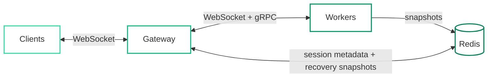

# ws-migrator

A Go library and gateway for **live migration** of WebSocket sessions between backend workers.

> **Note:** The project was inspired by LTE handover concepts and applies a similar idea to WebSocket sessions at the application level.

## Overview
ws-migrator keeps the client connection on a gateway and moves the session behind it from one worker to another. Workers can be drained or restarted while clients stay connected, keep their session state, and receive their messages in order. If a worker **crashes**, its sessions resume on another **healthy worker** from the **latest snapshot**, and recent messages are **replayed**.

Clients need no changes. Any WebSocket client works, and all migration logic lives in the gateway and the worker library.

## System Architecture



- **Gateway:** accepts client WebSockets, routes each session to a worker, numbers client messages, buffers them for resending, drops duplicate output and orchestrates handovers and recovery.
- **Workers:** run the application logic with the worker library and hold each session's state in memory.
- **Redis:** stores session snapshots for crash recovery.

## Features

- **Deploys without reconnecting:** when a worker is stopped gracefully, its sessions move to other workers.
  > **SIGTERM** is the standard stop signal that Docker and Kubernetes send to a process before shutting it down. Workers treat it as the cue to drain.
- **Crash recovery:** sessions are restored from Redis snapshots and recent messages are replayed in order. Requires the **gateway to stay up**, **Redis to be available** and another **healthy worker** to accept the session.
- **Ordered messages:** each session's messages are applied in order, and once each during a planned drain.
- **Effectively-once output:** replies and pushes are resent until the gateway acknowledges them, and the **gateway drops duplicates**. This does **not** confirm the client processed them, and a crash can lose output produced after the **latest snapshot**.
- **Load-aware placement:** sessions go to the **least loaded healthy worker**.
- **Fallbacks:** a failed handover resumes on the original worker, and **drains and recoveries** retry other healthy workers. A **new connection** tries one worker and fails if it can't be reached.
- **Self-registering workers:** token-protected registration with health monitoring. An **empty `REGISTER_TOKEN` disables authentication**.
- **Pluggable storage:** Redis by default, or any `store.Store` implementation.
- **Metrics:** JSON counters at `/admin/stats`.

## Requirements

- Go 1.25+
- Redis
- Docker (optional)
- Kubernetes (optional)

## Installation

```sh
go get github.com/Jana-Hassan/ws-migrator
```

## Quick Start

```sh
docker compose up -d --build
go run ./test/chat
```

Starts Redis, the gateway on `:8080`, two workers and a client. Then, in a **second terminal**:

```sh
docker compose stop worker-1
```

`worker-1`'s sessions move to `worker-2` while the client stays connected.

## Usage

Session state implements `Serialize` and `Restore`, which is what moves between workers.

```go
w := worker.NewWorker(worker.Config{
    ID:          "worker-1",
    WSAddr:      ":8081",
    GRPCAddr:    ":9091",
    GatewayAddr: "localhost:9090",
    Store:       store.NewRedis("localhost:6379"),
})

w.OnSessionCreate(func(id string) worker.State { return &Counter{} })

w.OnMessage(func(id string, s worker.State, msg []byte) []byte {
    c := s.(*Counter)
    c.Count++
    return []byte(fmt.Sprintf("count=%d", c.Count))
})

w.Start()
```

| API | Purpose |
|---|---|
| `OnMessage` | Reply to a client message |
| `Push` | Server-initiated message with an increasing key, deduplicated by the gateway |
| `Send` | Best-effort message |
| `Update` | Change state outside `OnMessage` |
| `OnSessionReady` / `OnSessionEnd` | Start and stop per-session work |

### Before You Integrate

> [!IMPORTANT]
> For **financial and transactional apps** (payments, orders, balances), messages newer than the latest snapshot can be replayed after a crash. The library deduplicates sequence numbers, but it does not deduplicate external side effects. Use your own **idempotency keys** for charges and other external operations.

Apps integrate through the **worker API**. It is **not a drop-in wrapper** for an existing WebSocket server. Any **Go WebSocket app** with **serializable per-session state** can import the library, but it must follow these rules for sessions to move safely:

- **Serializable state:** everything a session needs must survive `Serialize` and `Restore`.
- **Shared data outside workers:** only **per-session state** moves. Shared data belongs in the application's own storage.
- **Deterministic replies:** replies must depend only on **state and the message**, since messages are replayed after a crash.
- **Idempotent side effects:** database writes and external calls need their own **idempotency keys**.
- **Background changes through the library:** use `Update` or `Push`, and retry when they return `worker.ErrFrozen` during a handover.
- **Increasing push keys:** each `Push` key must be **higher than the previous one** for that session.
- **Overlapping hooks:** the new worker's `OnSessionReady` can run **before** the old worker's `OnSessionEnd`.
- **Graceful shutdown:** the worker process must receive **SIGTERM directly**, with a grace period **longer than the 30s drain timeout**.

## Configuration

**Gateway**

| Variable | Default | Purpose |
|---|---|---|
| `LISTEN_ADDR` | `:8080` | Client WebSocket and HTTP address |
| `GRPC_ADDR` | `:9090` | Worker control address |
| `REDIS_ADDR` | `localhost:6379` | Redis address |
| `REGISTER_TOKEN` | empty | Shared worker token |
| `WORKERS` | empty | Optional static worker list `id\|wsURL\|grpcAddr` |

**Worker**

| Variable | Default | Purpose |
|---|---|---|
| `WORKER_ID` | hostname | Unique worker id |
| `LISTEN_ADDR` | `:8081` | WebSocket address |
| `GRPC_ADDR` | `:9091` | gRPC address |
| `GATEWAY_ADDR` | `localhost:9090` | Gateway gRPC address |
| `REDIS_ADDR` | `localhost:6379` | Redis address |
| `WS_ADVERTISE` | hostname + port | WebSocket URL the gateway dials |
| `GRPC_ADVERTISE` | hostname + port | gRPC address the gateway dials |
| `REGISTER_TOKEN` | empty | Must match the gateway |

## Deployment

**Docker**

```sh
docker build --build-arg CMD=./cmd/gateway -t ws-migrator/gateway .
```

**Kubernetes**

```sh
kubectl apply -f deploy/k8s/
```

> **Note:** replace `replace-me-with-a-random-string` in `deploy/k8s/secret.example.yaml` with a random token **before deploying**.

## How It Works

**Worker selection**

- A worker is eligible only if it is **healthy** and **not draining**.
- New sessions and recoveries go to the eligible worker with the **fewest sessions**.
- A drain **spreads** its sessions across eligible workers by load, so no single worker is flooded.
- During **drains and recoveries**, if the chosen worker fails, the gateway **tries the next one**. A **new connection** does not retry.

**Planned drain**

1. The worker receives **SIGTERM** and asks the gateway to drain it.
2. The gateway **freezes** each session and takes a **checkpoint**.
3. The checkpoint is **restored** on another worker and missing messages are **resent**.
4. The gateway **switches** the session to the new worker.
5. The old worker exits once it has **no sessions left**, or after **30s**.

**Crash recovery**

1. Workers **snapshot** changed sessions to Redis, every **5s** by default (configurable with `SnapshotInterval`).
2. When a worker's connection **drops**, the gateway loads the last snapshot.
3. The session is restored on another worker and messages since the snapshot are **replayed**.

Recovery requires the **gateway to stay up**, **Redis to be available** and another **healthy worker** to accept the session.

**Delivery**

- **Effectively once** = **at-least-once delivery + gateway-side deduplication**. It is not a guarantee that the client processed the output.
- After a crash, output produced since the **latest snapshot** comes back only if **replay** rebuilds it.
- The gateway **numbers** client messages and keeps the last **1024** per session.
- Workers **skip** messages they have already applied.
- Replies and pushes stay in a worker **outbox** until the gateway **acknowledges** them.
- The gateway **drops** any reply or push it has already forwarded.

## Testing

```sh
go test ./...
go test -tags e2e ./test/e2e/ -v -timeout 40m
```

The end-to-end suite runs real processes and Redis on Docker Compose and Kind. It covers drains, killed workers, a Redis outage, rolling restarts and scaling.

> **Note:** the E2E tests **create and remove** a Docker Compose project and a Kind cluster named **`wsm-e2e`**. Don't run them if you have resources with that name you want to keep.

## Future Work

- **Gateway high availability:** multiple gateways with client session resume.
- **TLS:** encrypted client, gateway-to-worker and gRPC traffic.
- **Admin authentication:** protect the `/admin` endpoints.
- **Configurable resend buffer:** replace the fixed 1024-message limit.
- **Client acknowledgements:** confirm delivery to the client application, not just the gateway.
- **Benchmarks:** load and latency measurements on real networks.
